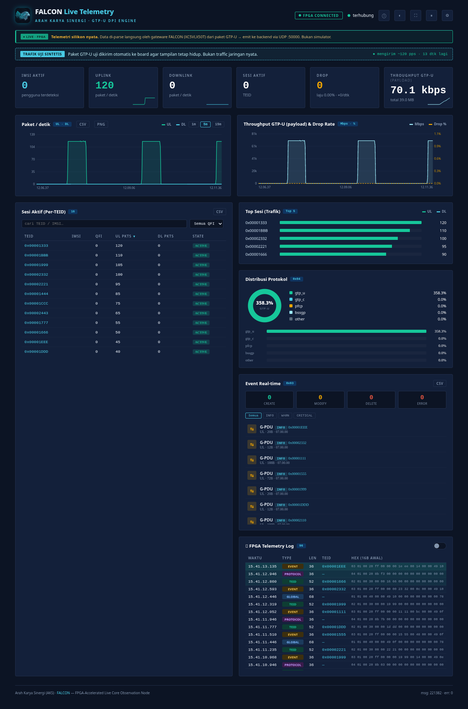
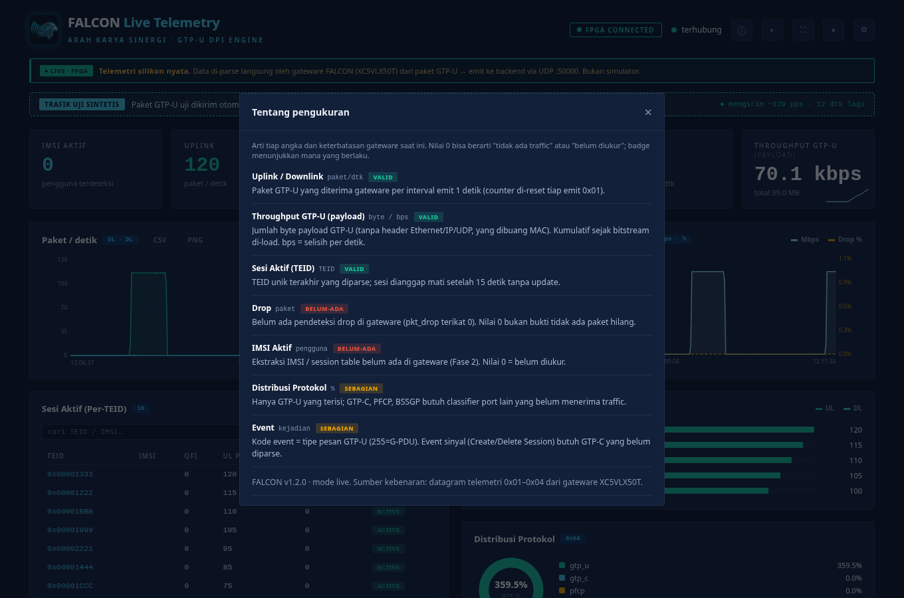
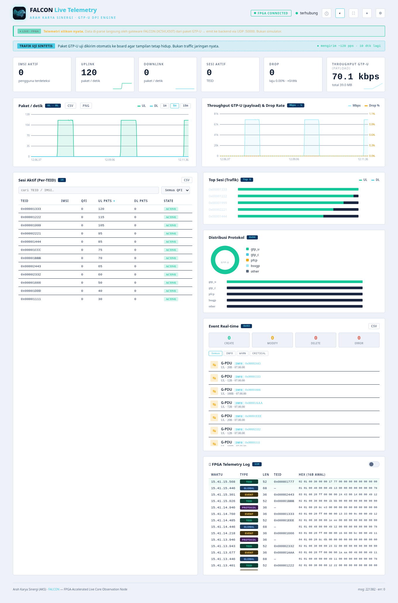
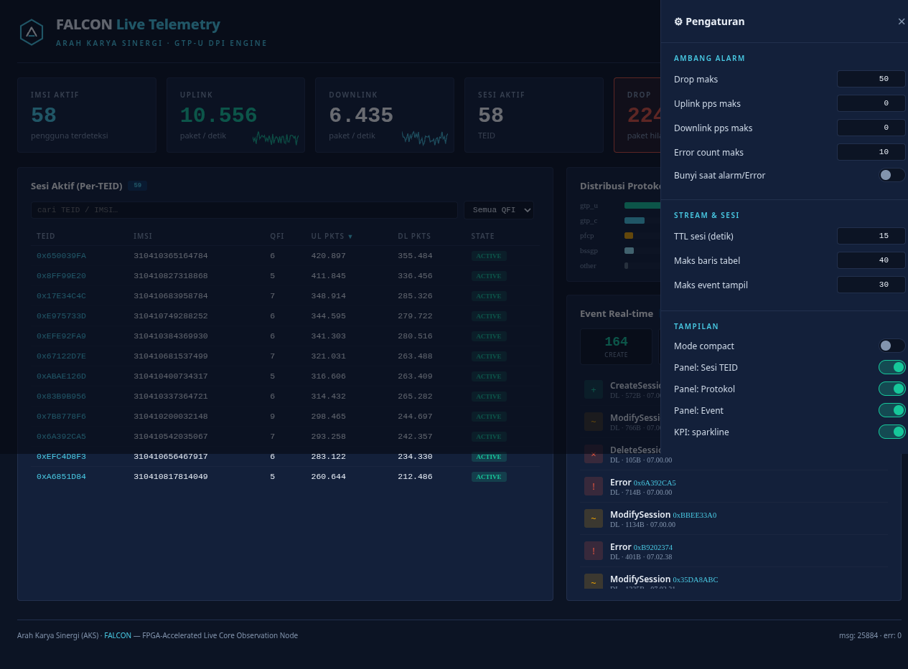
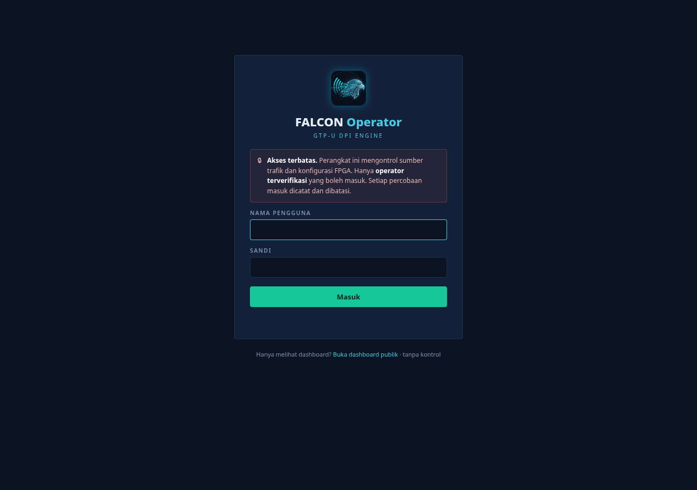
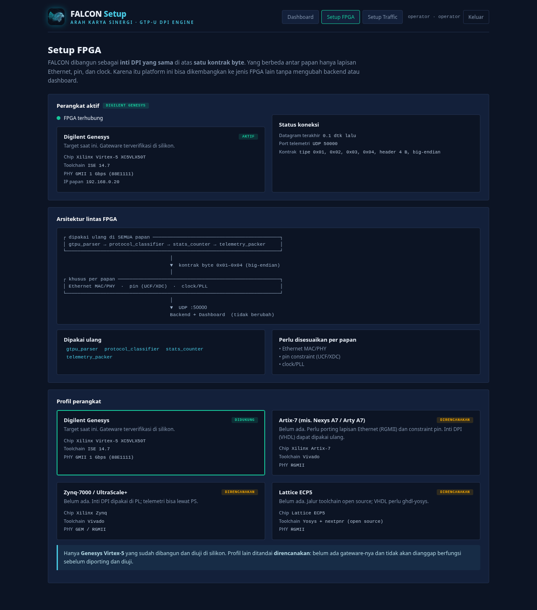
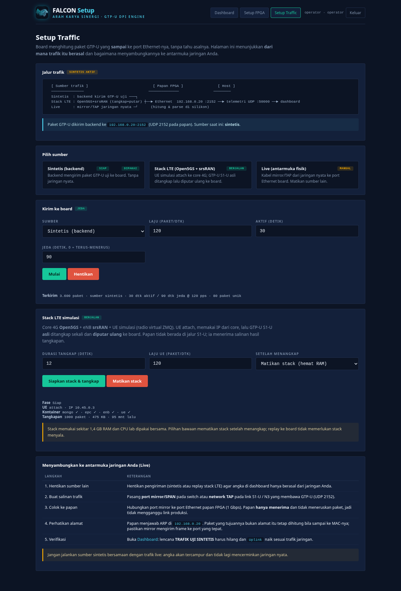

<div align="center">

# FALCON — FPGA-Accelerated Live Core Observation Node

**Line-rate GTP-U telemetry, parsed in silicon, observed live.**

[](https://falcon.arahkarya.com)
[](https://falcon.arahkarya.com)
[](https://github.com/ArahKarya/falcon)
[](LICENSE)
[](https://www.python.org/)
[](https://github.com/ArahKarya/falcon)
[](fpga/)
[](fpga/)

</div>

> A real-time **GTP-U Deep Packet Inspection (DPI)** monitoring system, hardware-accelerated by **FPGA**.
> Research collaboration: **[NOZ BERKARYA](https://github.com/noz-co-id/)** × **Arah Karya Sinergi (AKS)**.

---

## Overview

FALCON is a **telecom security and observability research platform** that moves GTP-U packet inspection from software into an FPGA. The gateware receives GTP-U frames on UDP `:2152`, parses them in hardware, and emits compact telemetry datagrams over UDP `:50000` to a host backend. The backend decodes them and streams the result live to a web dashboard.

The whole host stack is built around a **single byte contract** (`falcon/shared/contract.py`) used by both the gateware and the backend. A simulator that speaks the same contract lets the host side be developed and tested without the board.

**Status (November 2026):** the pipeline runs on real silicon. The board is programmed, the 1 Gbps link is up, and every metric on the dashboard is counted by the gateware, not by the host. The traffic fed to the board in the public demo is **synthetic or a replay of a simulated LTE network**, never a production network (see [Traffic modes](#traffic-modes)). Control pages are restricted to verified operators (see [Operator console](#operator-console)).

---

## Why FALCON

GTP-U (GPRS Tunnelling Protocol, User plane) carries all user data in 4G/5G core networks. Reading it at wire speed supports:

- **Observability:** how many sessions (TEIDs), how many packets, how much payload
- **Security research:** session lifecycle events and protocol-mix shifts
- **Traffic engineering:** uplink/downlink counters and drop detection

| Problem | FALCON approach |
|---|---|
| GTP-U parsing at line rate saturates a CPU | The FPGA parses in fabric. The host only receives small telemetry summaries |
| Binary telemetry desyncs easily between sender and receiver | One byte contract, verified byte-exact by the gateware testbenches |
| A malformed datagram can crash a collector | Bad datagrams are skipped and counted, the process stays up |
| Hardware not available during development | Contract-identical simulator for the full host stack |
| Need to see network state immediately | WebSocket push of KPI, sessions, events and protocol mix |

---

## Dashboard

Live at **[falcon.arahkarya.com](https://falcon.arahkarya.com)** (public and read-only: anything that changes state requires an operator login).

| Live telemetry | Measurement documentation |
|---|---|
|  |  |

| Light theme | Settings |
|---|---|
|  |  |

Features: KPI cards with sparklines, packet-rate and throughput charts (with drop rate), per-TEID session table with detail modal, Top-5 sessions, protocol distribution, real-time event feed with severity, FPGA link banner (connected / disconnected), CSV and PNG export, dark/light theme, **presentation mode**, and a **Measurement** modal that documents how each number is produced and whether it is validated.

---

## Operator console

The device is not meant to be driven by anyone who can reach the web page. The console is split into four pages:

| Page | Path | Access | Purpose |
|---|---|---|---|
| Login | `/login` | public | Verifies the operator before any control is shown |
| Dashboard | `/` | public, read-only | What the board measures |
| Setup FPGA | `/setup/fpga` | operator login | Which board is active, link state, what is reusable across boards |
| Setup Traffic | `/setup/traffic` | operator login | Where the traffic comes from and how to connect your own |

| Login | Setup FPGA |
|---|---|
|  |  |



**Authentication** (`falcon/backend/auth.py`): standard library only, no extra dependency. Passwords are hashed with `scrypt` and a per-user salt. Sessions are random tokens in an `HttpOnly`, `SameSite=Strict` cookie. Five failed logins lock the source for a while. The account file lives **outside the repository** with mode `0600` (`FALCON_USERS_FILE`). Two roles: `operator` (full control) and `viewer` (can read the setup pages, any change returns 403). Create accounts on the host, never over HTTP:

```bash
python3 falcon/backend/auth.py add <name> operator     # prints a random password once
python3 falcon/backend/auth.py add <name> viewer
```

Passwords are never rotated automatically and never written to logs.

**Setup FPGA** documents the part of the design that is board-independent (`gtpu_parser`, `protocol_classifier`, `stats_counter`, `telemetry_packer` and the byte contract) and the part that must be redone per board (Ethernet MAC/PHY, pin constraints, clocks). Only the Genesys Virtex-5 exists as gateware; the other profiles are listed as *planned* and are not faked.

---

## Architecture

```
                    ┌──────────────────────────────────┐
                    │           FPGA board              │
                    │   Genesys XC5VLX50T (Virtex-5)    │
                    │                                   │
 GTP-U frames ─────▶│  Ethernet MAC ─▶ UDP ─▶ DPI core  │──▶ LD0-LD7  (LED status)
 UDP :2152          │                          │        │──▶ LCD 16x2 (live numbers)
                    │          parse · classify · count │
                    │                          ▼        │
                    │              telemetry packer     │
                    └──────────────────────────┬────────┘
                                               │ UDP :50000  (0x01-0x04)
                                               ▼
                    ┌──────────────────────────────────┐
                    │ Backend  (aiohttp, Python async)  │
                    │  UDP listener · contract decode   │──▶ WebSocket /ws
                    │  state · link watcher · demo gen  │──▶ REST /api/*
                    └──────────────────────────┬────────┘
                                               ▼
                    ┌──────────────────────────────────┐
                    │ Dashboard (vanilla HTML/CSS/JS)   │
                    │  no framework, no build step      │
                    └──────────────────────────────────┘
```

---

## Telemetry wire format

All datagrams share a **4-byte header**, all fields **big-endian**.

```
 0        1        2        3
 ┌────────┬────────┬────────────────┐
 │msg_type│version │    length      │
 │  u8    │  u8    │    u16 BE      │
 └────────┴────────┴────────────────┘
```

`msg_type`: `0x01` Global, `0x02` TEID, `0x03` Event, `0x04` Protocol. `length` is the payload length, so a receiver can skip unknown future bytes.

### `0x01` Global stats — 64 B, about once per second

| Offset | Size | Field | Meaning |
|---|---|---|---|
| 0 | 4 | `ts` | Unix epoch (s) |
| 4 | 4 | `total_imsi` | Active IMSIs |
| 8 | 4 | `ul_pps` | Uplink packets in the last 1 s interval |
| 12 | 4 | `dl_pps` | Downlink packets in the last 1 s interval |
| 16 | 4 | `active_teid` | Active TEID sessions |
| 20 | 8 | `total_bytes` | Cumulative GTP-U **payload** bytes since the bitstream was loaded |
| 28 | 4 | `drop` | Drop count |
| 32 | 32 | padding | zero |

### `0x02` Per-TEID session — 48 B

`teid` u32 · `imsi` ascii[16] · `qfi` u8 · `state` u8 (0 IDLE, 1 ACTIVE, 2 SUSPENDED) · `ul_pkts` u32 · `dl_pkts` u32 · padding.

### `0x03` Session event — 32 B

`event_type` u8 (1 Create, 2 Delete, 3 Modify, 4 Error) · `direction` u8 · `teid` u32 · `packet_len` u16 · `ts` u32 · padding.

### `0x04` Protocol distribution — 32 B

`gtp_u`, `gtp_c`, `pfcp`, `bssgp`, `other`: five `u16`. See [Known issues](#known-issues) for how the gateware fills these today.

Self-test (pack → decode roundtrip): `python -m falcon.shared.contract`

---

## Traffic modes

The gateware counts whatever arrives on UDP `:2152`. It cannot tell where a packet came from, so the **source of the traffic** is a deployment fact, not a gateware fact. The dashboard badge tells the viewer which one is active.

| Mode | Source | Dashboard badge |
|---|---|---|
| **Synthetic** | The backend generates GTP-U test frames (`FALCON_DEMO_TRAFFIC`, or *Setup Traffic*) | **TRAFIK UJI SINTETIS** |
| **5G application simulator** | `traffic5g.py` generates GTP-U **with a QFI extension header** from eight application profiles (video, games, conferencing, best effort) | **SIMULATOR 5G** |
| **LTE stack replay** | GTP-U captured from a simulated 4G network (Open5GS core + srsRAN eNB and UE), replayed to the board | **REPLAY STACK LTE** |
| **Live** | A tap or port mirror from a real network cabled to the board's Ethernet port | none. Leave the other sources off |

The public demo runs a synthetic burst profile (30 s active, 90 s idle, 120 pps) so the dashboard is never empty. **Numbers from the demo are test traffic.**

### 5G application simulator

*Setup Traffic → Simulator 5G (profil aplikasi)* sends 5G-style user-plane traffic: GTP-U with the PDU Session Container extension (flags `0x34`, extension `0x85`, QFI in byte 14), one TEID per simulated UE.

**Where the data comes from, honestly.** The packet layout and the eight application profiles (packet-size histogram, inter-packet gap, per-second burst pattern) come from [niloysh/5g-traffic-generator](https://github.com/niloysh/5g-traffic-generator) (MIT, `falcon/backend/profiles/LICENSE-5g-traffic-generator`), whose profiles were derived from captured application traffic. The packet sequence, the payload bytes and the split into UE sessions are **generated here**. Treat it as *artificial traffic with real statistics*, not as operator traffic. The dashboard badge says so.

| Setting | Meaning |
|---|---|
| Composition | `campuran` (default share per app from the reference project), `video`, `game`, `konferensi` |
| UEs | 1 to 1000 sessions, each with its own TEID and the QFI of its application |
| Burst | 0 = flat rate, 1 = follow the recorded per-second pattern (profiles with fewer than 30 trace points are kept flat) |
| Spike | Multiplies the rate of one application for a set time, to test anomaly handling |

Checks that back this up: `fpga/sim/run_qfi_test.sh` (the parser is correct on 50 frames of the reference generator: TEID, message type and exact payload length), `scripts/test_traffic5g.py` (byte-identical to the reference packets, size and rate distributions, determinism), `scripts/test_sim5g.sh` (auth, validation and packets observed on the wire).

### Session KPIs and simulated IMSI labels

The gateware does not fill `total_imsi` or `active_teid` yet (needs a session table and a GTP-C parser, phase 2), and a GTP-U data packet carries no IMSI at all. The backend therefore fills two things, and says so on screen:

| Field | What the backend does | Honest limit |
|---|---|---|
| `active_teid` (Sesi Aktif) | Counts TEIDs still alive in the table (`FALCON_TEID_TTL`, default 15 s). Flagged `active_teid_derived`. | The gateware reports a **sample** (one TEID datagram per 64 packets), so rarely used sessions appear late. |
| IMSI / `total_imsi` | Assigns a **fictitious** IMSI per TEID (PLMN `001-01`, the ITU test network), only while a synthetic source is on (demo or simulator). Tagged `SIM`. | Never invented on live traffic. A value from the gateware always wins and is never overwritten. |

**IMSI masking.** An IMSI identifies a subscriber, so the backend never sends a full one out. REST (`/api/stats/teid`, `/api/snapshot`), the WebSocket feed and the raw log show only the **first 3 digits** (MCC), the rest as `*` (e.g. `510************`). This applies to real IMSIs from the gateware too, not only simulated labels, and cannot be switched off over the API. The full value stays in backend memory only to count unique users. The raw log also cuts the hex preview of TEID datagrams before the IMSI bytes. Set `FALCON_IMSI_SHOW` (default `3`) only for a private lab. Checks: `scripts/test_imsi_mask.sh` (19: REST, snapshot, WebSocket, raw log, simulated and real IMSI).

Checks: `scripts/test_session_imsi.sh` (23: labels only on synthetic sources, none on live traffic, gateware values never overwritten, TTL expiry).

### Process terminal (Setup pages only)

Setup FPGA and Setup Traffic show a live, **read-only** terminal of what is happening to the board, so an operator can follow a gateware load step by step instead of waiting for a final "done".

| What | Where it comes from |
|---|---|
| iMPACT / `fpgactl.sh` output | Streamed **line by line while it runs** (cable found, chain read, `xc5vlx50t` detected, programmed, DONE pin, telemetry back). iMPACT's preference table and version noise is filtered, key lines are summarised in Indonesian. |
| `stackctl.sh` output | Same, for the LTE stack (up / capture / down). |
| Board link | One line **only when the state changes** (connected / lost), never every second. |
| Traffic source | Active / pause phases and stop events. |

Safety: no command box and no endpoint that takes a command (the browser cannot run anything); every line is filtered before it is stored (IMSI masked to 3 digits, passwords / tokens / bearer values removed, host paths shortened); kept in memory only (500 lines, lost on restart); reachable only after login (`/api/setup/log`, not in the public path list), and only operators may clear it. The main dashboard has no terminal. Checks: `scripts/test_term.sh` (38).

### LTE stack source

*Setup Traffic → Stack LTE simulasi* prepares the simulated network, captures real GTP-U from its S1-U interface, and replays that capture to the board.

```
 UE (srsue) ──ZMQ──► eNB (srsenb) ──S1-U GTP-U──► SGW-U/UPF (Open5GS)
                          │  UDP 2152, 192.168.0.131 → .130
                          └──► tcpdump (captured once) ──► backend replay ──► board :2152
```

1. **Prepare & capture** starts the EPC (HSS, MME, SGW-C/U, SMF, UPF, PCRF), the eNB and a UE that attaches and sends traffic, then captures S1-U. By default the stack is stopped afterwards to free about 1.4 GB of RAM.
2. **Start** with source *Replay stack LTE* loops the captured payloads to the board. The stack does not need to be running for the replay.
3. The board is **not** in the S1-U path. It receives a copy, so it never interferes with the simulated network.

Honest limits: the radio is virtual (ZMQ, 6 PRB / 1.92 MHz so a 4-core machine keeps up), the network is **4G (LTE)**, not 5G NSA, and the replayed packets keep their payload but get new outer addresses. The backend calls only `scripts/stack/stackctl.sh` with four fixed actions (`status`, `up`, `capture`, `down`); it never runs arbitrary commands.

Measured on the real board with this path: 400 captured packets of 236 B raised `total_bytes` by exactly **94 400**, with `ul_pps` steady at 100.

---

## Board indicators

The Genesys board shows live state without any computer. Every indicator is driven by a real signal.

### LEDs (`fpga/eth/led_status.v`)

| LED | Meaning |
|---|---|
| LD0 | Heartbeat, 1 Hz, always blinking while the gateware runs |
| LD1 | A GTP-U packet was accepted (stretched pulse) |
| LD2 | A telemetry datagram was sent |
| LD3 | An Ethernet frame was received |
| LD4–LD7 | Load bar: ≥1, ≥100, ≥1 000, ≥10 000 GTP-U packets/s |

### LCD 16×2 (`fpga/eth/lcd_status.v`)

Line 1 is always `FALCON UL <pps>`. Line 2 rotates every 3 s through four pages:

```
Rate 0000.28Mbps     payload rate, 2 decimals
Tot 0000289440 B     cumulative payload bytes
Pkt 000000009120     cumulative GTP-U packets
Up   00:03:12        uptime since bitstream load
```

The LCD has **no backlight**; read it under room light and adjust the contrast trimmer if the text is faint. The interface is **write-only**: `R/W` is tied low and no pin is ever an input from the 5 V LCD, so the FPGA is never driven by it. Pins come from the Genesys Reference Manual (Bank 18).

---

## FPGA gateware

**Target:** Xilinx Virtex-5 XC5VLX50T (Digilent Genesys) · **Toolchain:** ISE 14.7 · **Simulation:** GHDL and Icarus Verilog

| Block | File | Function |
|---|---|---|
| Ethernet / UDP | `fpga/eth/fpga_core.v` + `v5io/` | MAC, ARP, UDP on the Genesys GMII PHY (IP `192.168.0.20`) |
| GTP-U parser | `fpga/rtl/gtpu_parser.vhd` | Ethernet → IPv4 → UDP → GTP-U, extracts TEID, counts payload bytes |
| Classifier | `fpga/rtl/protocol_classifier.vhd` | Class by UDP port |
| Stats | `fpga/rtl/stats_counter.vhd` | Per-interval pps, total bytes, drops |
| Packer | `fpga/rtl/telemetry_packer.vhd` | Builds `0x01`–`0x04` datagrams, byte-exact to the contract |
| Top | `fpga/rtl/falcon_top.vhd` | Integration and emit arbiter |
| Indicators | `fpga/eth/led_status.v`, `lcd_status.v` | LEDs and LCD |

### Simulate

```bash
fpga/sim/run_all.sh              # packer byte-exact + parser (GHDL)
fpga/sim/run_imsi_test.sh        # IMSI parsing, 8/8 TEID
fpga/sim/run_rate_clear.sh       # ul_pps is per-second, not cumulative

cd fpga/eth
iverilog -g2012 -o /tmp/led tb_led_status.v led_status.v && vvp /tmp/led
iverilog -g2012 -o /tmp/lcd tb_lcd_status.v lcd_status.v && vvp /tmp/lcd
```

`tb_lcd_status` models an HD44780 controller and checks the init sequence, minimum delays between instructions, `E` pulse width, `R/W` low, and the rendered DDRAM contents.

### Build and program

```bash
# Synthesis (ISE 14.7). Edit WORK in the script to a private build folder first.
bash fpga/eth/build_eth_ise.sh        # -> <WORK>/genesys_fpga.bit

# Program over JTAG (Platform Cable USB II) with iMPACT in batch mode,
# then restore the host address
impact -batch prog.cmd
sudo ip addr add 192.168.0.101/24 dev enp2s0
```

The bitstream is **volatile** (SRAM): it is lost at power-off. Flashing it to the board PROM is on the roadmap. Build outputs are git-ignored; the `.bit` is not stored in this repo.

### Fixes validated on hardware

| Issue | Cause | Fix |
|---|---|---|
| `ul_pps` grew without bound | `rate_clear` was hard-wired to `'0'` | Clear on the 1 s emit; regression `tb_rate_clear` |
| `total_bytes` always 0 | `r_ulen` was never assigned in the parser | Count the actual AXIS payload bytes |
| LEDs showed the first byte of the last datagram | Debug leftover | Replaced by the real-signal indicators above |

---

## Backend

`falcon/backend/server.py`: one `asyncio` + `aiohttp` process.

- UDP listener on `:50000`, decode via `contract.py`; malformed datagrams are counted, never fatal
- In-memory state: global KPI, TEID map with TTL, event ring buffer, protocol mix, history
- Derived values: `bps`, `drop_rate`, event severity, FPGA link status (connected if a datagram arrived recently)
- Synthetic IMSI per TEID when the gateware does not supply one, masked as `MCC+MNC ****** last3`
- WebSocket push and REST API
- Optional demo traffic task (`FALCON_DEMO_TRAFFIC=burst:ON:OFF:PPS`)

### Environment

| Variable | Default | Meaning |
|---|---|---|
| `FALCON_UDP_PORT` | `50000` | Telemetry listener |
| `FALCON_HTTP_PORT` | `8080` | Dashboard, REST, WebSocket |
| `FALCON_MODE` | `live` | `live` (real board) or `sim` (simulator banner) |
| `FALCON_PUBLIC` | `0` | `1` = reject `POST /api/generator/*` with 403 |
| `FALCON_DEMO_TRAFFIC` | empty | `burst:30:90:120` = 30 s on, 90 s off, 120 pps. Empty = off |
| `FALCON_DEMO_TARGET` | `192.168.0.20:2152` | Where the demo traffic is sent |
| `FALCON_USERS_FILE` | `~/.falcon/users.json` | Operator accounts (scrypt hashes, mode 0600, outside the repo) |
| `FALCON_STACK_DIR` | empty | Directory of the LTE stack (compose file and `pcap/`). Empty = stack source shown as not installed |
| `FALCON_STACK_IF` | `enp2s0` | Interface used to capture S1-U |

### REST API

| Endpoint | Method | Description |
|---|---|---|
| `/api/health` | GET | Status, uptime, message and error counts |
| `/api/version` | GET | Name, version, ports, mode |
| `/api/link` | GET | FPGA link status and age of the last datagram |
| `/api/stats/global` | GET | Latest global KPI (`0x01`) |
| `/api/stats/teid` | GET | Active TEID sessions (`0x02`) |
| `/api/stats/protocol` | GET | Protocol distribution (`0x04`) |
| `/api/events` | GET | Recent events, `?limit=N` |
| `/api/events/counter` | GET | Event count per type |
| `/api/history` | GET | History for charts, `?window=` |
| `/api/snapshot` | GET | Full state in one response |
| `/api/measure` | GET | How each metric is measured and its validation status |
| `/api/demo` | GET | Demo traffic state |
| `/api/rawlog` | GET | Raw datagram log |
| `/api/generator/status` · `start` · `stop` | GET / POST / POST | Packet generator control (blocked when `FALCON_PUBLIC=1`) |
| `/api/login` · `/api/logout` · `/api/me` | POST / POST / GET | Operator session |
| `/api/setup/fpga` · `/api/setup/traffic` | GET | Setup pages data (login required) |
| `/api/traffic/start` · `stop` | POST | Start or stop test traffic; `source` = `synthetic`, `stack-lte` or `sim-5g` (operator only) |
| `/api/sim5g` | GET | Simulator state: sessions, per-app counters, TEID to app map (operator only) |
| `/api/sim5g/inject` | POST | Rate spike `{factor, seconds, app?}` on the running simulator (operator only) |
| `/api/stack/prepare` · `stop` | POST | Start the LTE stack and capture, or stop it (operator only) |

`ws://<host>:<port>/ws` sends a snapshot on connect, then per-update frames.

---

## Quickstart

### With the real board

```bash
# 1. Program the board and restore the host address (see "Build and program")
# 2. Backend
cd falcon/backend && python3 server.py          # or: systemctl start falcon-be
# 3. Feed it traffic: synthetic test traffic from this host ...
python3 scripts/send_gtpu.py 40000 12000        # 40 000 packets at 12 000 pps
#    ... or cable a real GTP-U tap into the board's Ethernet port
curl -s http://localhost:8080/api/health
```

### Without hardware

```bash
python3 -m venv .venv && source .venv/bin/activate && pip install aiohttp
python -m falcon.backend.server               # terminal 1
python -m falcon.simulator.sim                # terminal 2 (same byte contract)
# open http://127.0.0.1:8080/
```

---

## Repository layout

```
falcon/
├── README.md · LICENSE · INTEGRATION.md
├── falcon/
│   ├── shared/contract.py        byte contract 0x01-0x04 (source of truth)
│   ├── simulator/sim.py          contract-identical emulator
│   ├── backend/                  server.py (UDP + WebSocket + REST), auth.py (operator login),
│   │                             stack.py + gtpu_pcap.py (LTE stack source)
│   └── dashboard/                index.html, login.html, setup-fpga.html, setup-traffic.html, nav.js, setup.css
├── fpga/
│   ├── rtl/                      DPI core (VHDL)
│   ├── eth/                      Ethernet/UDP, LED and LCD indicators (Verilog), UCF, build script
│   ├── tb/  sim/                 testbenches, golden vectors, run scripts
│   └── constraints/              pin notes
├── scripts/                      send_gtpu.py · replay_gtpu.py · gen_loop.sh · falcon-gen
│   ├── stack/                    stackctl.sh (fixed actions) · ue_traffic.pl
│   └── test_*.sh / test_*.py     auth, stack and protocol-normalisation tests
├── deploy/                       falcon-be.service
└── docs/                         BRD, PRD, DOKUMENTASI (Indonesian), screenshots
```

---

## Known issues

These are open and visible on the live dashboard today.

1. **Protocol distribution is normalised on the host, not in the gateware.** The gateware sends the raw 16-bit packet count of each class (`lo16(count)`) in `0x04`, while the contract says percentage ×100. The backend now turns the counts into percentages (the response carries `normalized` and `raw_total`). Because the count wraps at 65 535, the ratio can drift on long runs; the real fix is to send percentages from the gateware.
2. **Active IMSI and Active TEID KPI can read 0** while the session table is filled. The top-level counters (`total_imsi`, `active_teid`) are not yet driven from the session table.
3. **Downlink path is not implemented.** The board counts uplink only, so `dl_pps` is 0.
4. **IMSI is synthetic.** Real IMSI extraction from GTP-C/NAS is not in the gateware.
5. **Bitstream is volatile.** It must be reloaded after every power cycle.
6. **The LTE stack is 4G, not 5G NSA.** A real NSA setup (LTE anchor plus NR secondary) is not configured.

---

## Roadmap

- Send protocol percentages from the gateware and drive the IMSI/TEID KPI counters from the session table
- Persist the bitstream to the board PROM and make the host address `192.168.0.101` persistent
- `SIM` / `LIVE` / `IDLE` status on the LCD, from the packet source
- 5G NSA source: LTE anchor plus NR secondary instead of LTE only
- tshark correlation: capture `:2152` in and `:50000` out and compare TEIDs as proof of parsing in silicon
- Downlink path, real IMSI extraction, multi-protocol capture (GTP-C, PFCP, BSSGP)
- Per-session detail view in the dashboard

---

## Stack

| Layer | Technology |
|---|---|
| Gateware | VHDL · Verilog · Xilinx ISE 14.7 · Virtex-5 XC5VLX50T |
| Simulation | GHDL · Icarus Verilog · Open5GS + srsRAN (LTE traffic source) |
| Backend | Python 3.13 · asyncio · aiohttp · WebSocket |
| Frontend | Vanilla HTML/CSS/JS · no framework · no build step |
| Deployment | systemd · Cloudflare tunnel |
| State | In-memory (proof of concept) · no database |

---

## License

MIT, see [LICENSE](LICENSE).

---

<div align="center">
<sub>© 2026 Arah Karya Sinergi (AKS) × <a href="https://github.com/noz-co-id/">NOZ BERKARYA</a> · FALCON Research Platform</sub>
</div>
